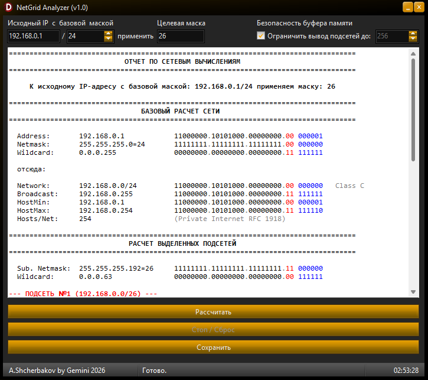

# NetGrid Analyzer (v1.0)

### 📥 [Скачать готовый NetGrid Analyzer (v1.0).exe (v1.0.0 Stable)](https://github.com/shcherbakov-admin/NetGrid-Analyzer/releases/download/v1.0.0/NetGridSuite.exe)
* **Программа компилируется в один независимый нативный бинарник. Запускается мгновенно, не требует установки, СУБД и тяжелых рантаймов. Идеально для работы с админской флешки.**
💡 **Рекомендация по запуску:** Для корректного сохранения локальной конфигурации (автоматически создаваемого файла `config.ini`) рекомендуется поместить исполняемый файл `.exe` в отдельную постоянную папку на диске и запускать его от туда с помощью ярлыка.
---

Десктопная утилита для автоматизации сетевых вычислений, планирования адресного пространства IPv4 и деления сетей на подсети (CIDR/VLSM). 

Приложение разработано на языке Object Pascal как внутренний инструмент для сетевых инженеров и системных администраторов, позволяющий быстро генерировать структурированные отчеты по распределению хостов.

## Технические особенности реализации

* **Алгоритм вычислений:** Расчет сетевых параметров (Network ID, Broadcast, Wildcard, Host Range) вынесен в отдельный модуль `IPCalcEngine` и реализован на базовых побитовых операциях со смещением (`shl`, `shr`, `and`, `or`, `not`) над беззнаковыми типами `UInt32`, что исключает накладные расходы на строковый парсинг в процессе математических операций.
* **Обработка пограничных стандартов:** В движке реализована корректная поддержка стандартов RFC 1918 (определение частных подсетей) и RFC 3021 (специфическая логика для PtP-линков `/31` и одиночных хостов `/32` с адаптацией вывода системных строк для исключения дублирования адресов).
* **Ограничение нагрузки на UI:** Для предотвращения чрезмерного расхода памяти и зависания интерфейса Windows при генерации больших диапазонов (например, деление сети `/8` на `/30`) в цикле вычислений установлено жесткое ограничение на вывод — не более 7 999 строк в компонент `TRichEdit`. При этом итоговые кумулятивные данные в конце отчета всегда рассчитываются со 100% математической точностью.
* **Интерактивное управление процессом:** Использование `Application.ProcessMessages` в цикле генерации строк сохраняет отзывчивость интерфейса, позволяя пользователю прервать ресурсоемкий расчет в любой момент нажатием кнопки «Стоп» без аварийного завершения работы программы.
* **Санитаризация ввода:** Реализована базовая фильтрация ввода символов в реальном времени (событие `OnKeyPress`), автоматически обрабатывающая ошибочные раскладки клавиатуры (замена русских букв «б» и «ю», а также запятых на стандартный разделитель октетов — точку).
* **Интеллектуальное цветовое кодирование (Syntax Highlighting):** Для повышения читаемости отчетов реализован алгоритм динамической подсветки бинарных и строковых данных.
* **Экспорт данных:** Интегрирована функция сохранения сформированных отчетов в текстовые форматы RTF и DOC.

## Технологический стек
* **Язык программирования:** Object Pascal (Delphi)
* **Среда разработки:** Embarcadero RAD Studio 13.1
* **Используемые компоненты и API:** WinAPI (`Winapi.Messages` для RichEdit, позиционирование ProgressBar внутри StatusBar через `SB_GETRECT`), стандартная библиотека VCL.
